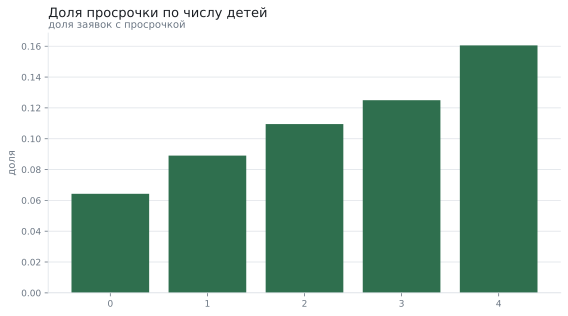
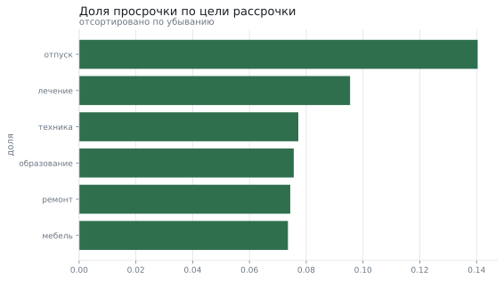
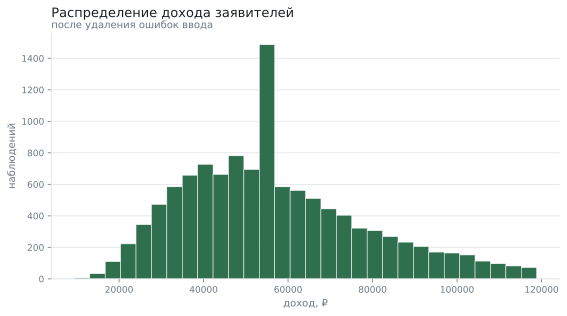

# Кто не возвращает рассрочку

**Вопрос:** Какие признаки заявителя действительно связаны с просрочкой по рассрочке?

**Данные:** 12120 заявок на рассрочку: возраст, доход, стаж, дети, цель, сумма и срок. Набор создаётся генератором с зафиксированным зерном и лежит рядом в «данные.csv».

**Метод:** подготовка данных, доли просрочки по группам, критерий хи-квадрат с размером эффекта (V Крамера) и поправка Холма на четыре проверки

## Что пришло

Исходные данные: строк 12120; полных дублей 120; пропуски: доход — 7.0%, стаж — 4.0%. Пропуски в доходе и стаже — обычное дело: эти поля заполняет менеджер вручную.

| Поле | Тип | Пропусков | Доля пропусков | Уникальных | Пример |
|---|---|---|---|---|---|
| возраст | int64 | 0 | 0.0% | 57 | 41 |
| доход | float64 | 848 | 7.0% | 11152 | 55664.97 |
| стаж | float64 | 484 | 4.0% | 46 | 19.0 |
| детей | int64 | 0 | 0.0% | 5 | 1 |
| цель | str | 0 | 0.0% | 6 | образование |
| семейное_положение | str | 0 | 0.0% | 4 | в разводе |
| сумма | float64 | 0 | 0.0% | 11586 | 111161.88 |
| срок_месяцев | int64 | 0 | 0.0% | 5 | 6 |
| просрочка | int64 | 0 | 0.0% | 2 | 0 |

## Что сделали с данными

Подготовка: убрано дублей 120, выбросов 535; было 12120 строк, стало 11465. Пропущенный доход заполнен медианой по возрастной группе, а не общей медианой: у двадцатилетних и сорокалетних это разные деньги. «доход»: обычные значения от -1 385 до 111 204, за границами 164 наблюдений (1.4%) — такие заявки убраны как ошибки ввода.

## Проверка четырёх гипотез

Общая доля просрочки — 8,4%. Каждая гипотеза проверена критерием хи-квадрат; поправка Холма нужна, потому что проверок несколько.

| Гипотеза | p-значение | V Крамера | Значима | С поправкой Холма |
|---|---|---|---|---|
| Просрочка связана с числом детей | 0.0000 | 0.082 | да | да |
| Просрочка связана с целью рассрочки | 0.0000 | 0.072 | да | да |
| Просрочка связана с семейным положением | 0.6680 | 0.012 | нет | нет |
| Просрочка связана со сроком рассрочки | 0.1535 | 0.024 | нет | нет |

## Дети

Доля просрочки растёт вместе с числом детей — это самая заметная связь в наборе.

## Цель рассрочки

Рассрочка на отпуск заканчивается просрочкой заметно чаще, чем на технику или мебель.

| Цель | Заявок | Доля просрочки |
|---|---|---|
| отпуск | 1 154 | 14,0% |
| лечение | 1 383 | 9,5% |
| техника | 3 225 | 7,7% |
| образование | 1 402 | 7,6% |
| ремонт | 2 017 | 7,4% |
| мебель | 2 284 | 7,4% |

## Доход

Различие есть: доли доход выше медианы и доход ниже медианы отличаются (7.73% против 9.14%, разница -1.41% (доверительный интервал от -2.43% до -0.39%)).

## Что получилось

1. Общая доля просрочки — 8,4%; это опорное число для любых сравнений.
2. После поправки на множественные сравнения значимыми остаются: Просрочка связана с числом детей, Просрочка связана с целью рассрочки.
3. Заявители с доходом выше медианы допускают просрочку реже: различие есть: доли доход выше медианы и доход ниже медианы отличаются (7.73% против 9.14%, разница -1.41% (доверительный интервал от -2.43% до -0.39%)).
4. Размеры эффекта малы (V Крамера меньше 0,1): признаки связаны с просрочкой, но по одному из них решение принимать нельзя.

## Чего это не доказывает

- Данные синтетические: зависимости в них заложены генератором, поэтому выводы показывают метод, а не рынок.
- Связь не означает причину: у заявителей с детьми выше не «риск как таковой», а расходы.
- Скоринговой модели здесь нет: это разведочный анализ, а не оценка кредитоспособности.
- Отказы в рассрочке в данные не попали, поэтому выборка смещена: мы видим только одобренные заявки.

*Отчёт собран 12.09.2026 командой `analiz`; данные воспроизводимы по зерну.*
