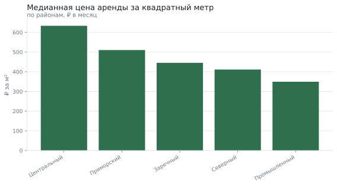
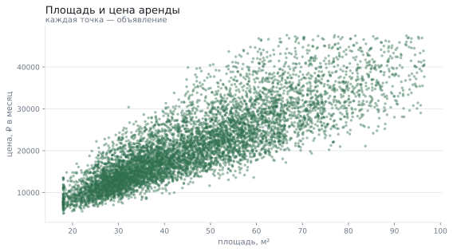
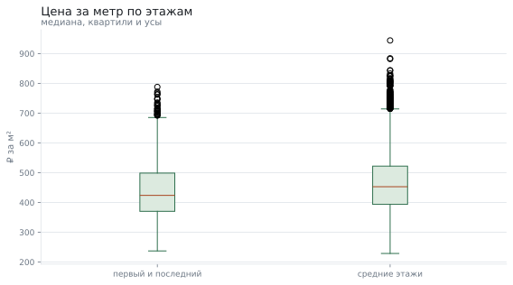
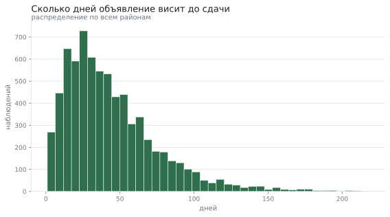

# От чего зависит цена аренды квартиры

**Вопрос:** Что сильнее влияет на цену аренды: площадь, район или этаж?

**Данные:** 8096 объявлений об аренде: район, площадь, число комнат, этаж, расстояние до центра, цена и срок публикации. Набор воспроизводим по зерну и лежит рядом в «данные.csv».

**Метод:** подготовка данных, границы выбросов по межквартильному размаху, медианы по районам, корреляция Спирмена и критерий Манна–Уитни для сравнения этажей

## Что пришло

Исходные данные: строк 8096; полных дублей 96; пропуски: до_центра_км — 5.0%. Расстояние до центра заполняется не всегда — его указывает продавец.

| Поле | Тип | Пропусков | Доля пропусков | Уникальных | Пример |
|---|---|---|---|---|---|
| район | str | 0 | 0.0% | 5 | Северный |
| комнат | int64 | 0 | 0.0% | 4 | 2 |
| площадь | float64 | 0 | 0.0% | 886 | 56.7 |
| этаж | int64 | 0 | 0.0% | 25 | 7 |
| этажей_в_доме | int64 | 0 | 0.0% | 24 | 19 |
| до_центра_км | float64 | 403 | 5.0% | 179 | 3.8 |
| цена | float64 | 0 | 0.0% | 7989 | 27668.74 |
| дней_в_публикации | int64 | 0 | 0.0% | 199 | 77 |

## Что сделали с данными

Подготовка: убрано дублей 96, строк с пропусками 400, выбросов 309; было 8096 строк, стало 7291. «цена»: обычные значения от -5 532 до 47 700, за границами 258 наблюдений (3.2%) — в объявлениях это опечатки в нулях. Дальше везде считается медиана: одно объявление за миллион смещает среднее, медиану — нет.

## Районы

Разница между самым дорогим и самым дешёвым районом — 81,4% по цене за метр.

| Район | Объявлений | Медиана цены | Медиана за м² |
|---|---|---|---|
| Центральный | 948 | 26 458 ₽ | 634 ₽ |
| Приморский | 1 520 | 22 102 ₽ | 510 ₽ |
| Заречный | 1 932 | 19 148 ₽ | 445 ₽ |
| Северный | 1 714 | 17 411 ₽ | 411 ₽ |
| Промышленный | 1 177 | 15 176 ₽ | 349 ₽ |

## Площадь и расстояние

Связь площади и цены — 0.86 по Спирмену: это сильная монотонная связь. Связь расстояния до центра и цены за метр — -0.16: слабее, но заметна и направлена вниз.

## Этаж

Различие есть: распределения первый и последний этаж и средние этажи отличаются (медианы 423.89 и 452.95); эффект пренебрежимо малый (-0.15).

## Сколько висит объявление

Быстрее всего уходят квартиры в районе «Заречный» — медиана 36 дней; дольше всего в «Центральный» — 38 дней.

## Что получилось

1. Площадь объясняет цену лучше всего: связь по Спирмену 0.86.
2. Район добавляет к цене метра до 81,4%.
3. Различие есть: распределения первый и последний этаж и средние этажи отличаются (медианы 423.89 и 452.95); эффект пренебрежимо малый (-0.15).
4. Половина объявлений уходит быстрее 37 дней.

## Чего это не доказывает

- Данные синтетические: зависимости заложены генератором, поэтому числа иллюстрируют метод, а не рынок города.
- В наборе нет ремонта, мебели и вида из окна — а они влияют на цену не меньше этажа.
- Цена в объявлении не равна цене сделки: торг в данных не отражён.
- Выбросы удалены по межквартильному размаху; для дорогого сегмента это спорный приём, и при другой задаче их пришлось бы анализировать отдельно.

*Отчёт собран 12.09.2026 командой `analiz`; данные воспроизводимы по зерну.*
