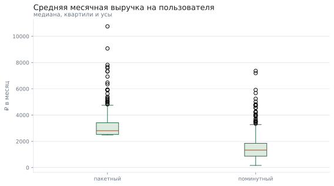
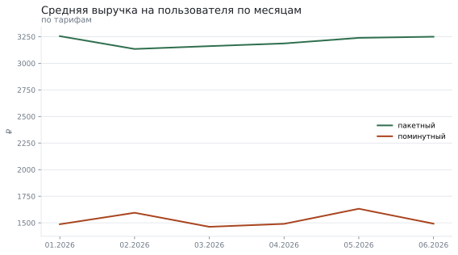

# Какой тариф каршеринга приносит больше

**Вопрос:** Приносит ли пакетный тариф больше выручки на пользователя, чем поминутный?

**Данные:** 5443 записей: 900 пользователей за 6 месяцев, поездки, минуты и выручка по двум тарифам. Набор воспроизводим по зерну и лежит рядом в «данные.csv».

**Метод:** подготовка данных, помесячная выручка на пользователя, проверка равенства дисперсий (Левен), критерий Стьюдента или Уэлча, размер эффекта и доверительные интервалы

## Что пришло

Исходные данные: строк 5443; полных дублей 43; пропуски: минут — 3.0%.

| Поле | Тип | Пропусков | Доля пропусков | Уникальных | Пример |
|---|---|---|---|---|---|
| пользователь | int64 | 0 | 0.0% | 900 | 1 |
| город | str | 0 | 0.0% | 3 | Самара |
| тариф | str | 0 | 0.0% | 2 | пакетный |
| месяц | object | 0 | 0.0% | 6 | 2026-01-01 |
| поездок | int64 | 0 | 0.0% | 20 | 8 |
| минут | float64 | 162 | 3.0% | 3084 | 1018.3 |
| выручка | float64 | 0 | 0.0% | 3977 | 7948.91 |

## Что сделали с данными

Подготовка: убрано дублей 43, строк с пропусками 162; было 5443 строк, стало 5238. Дальше сравниваются не отдельные месяцы, а средняя выручка на пользователя: иначе активные клиенты попадут в выборку по шесть раз и создадут видимость большей выборки, чем есть.

## Сравнение тарифов

Различие есть: средние пакетный тариф и поминутный тариф отличаются (разница средних +1671.30); эффект большой (+1.66).

| Тариф | Пользователей | Средняя выручка | Доверительный интервал |
|---|---|---|---|
| пакетный | 344 | 3 206 ₽ | 3 091 ₽ — 3 320 ₽ |
| поминутный | 556 | 1 534 ₽ | 1 454 ₽ — 1 614 ₽ |

## Как это менялось по месяцам

Разрыв между тарифами держится все шесть месяцев — это не разовый выброс одного месяца.

## Города

Картина по городам одинаковая — вывод не держится на одном рынке.

| Город | Пакетный | Поминутный | Разница |
|---|---|---|---|
| Казань | 3 137 ₽ | 1 505 ₽ | 108,4% |
| Самара | 3 354 ₽ | 1 622 ₽ | 106,9% |
| Тюмень | 3 140 ₽ | 1 423 ₽ | 120,6% |

## Что получилось

1. Пакетный тариф приносит в среднем на 1 671 ₽ в месяц больше на пользователя.
2. критерий Стьюдента: p = 0.0000 (есть различие), размер эффекта d 1.66
3. Размер эффекта — большой: разница не только значима, но и заметна.
4. Во всех трёх городах направление одинаковое, поэтому вывод не объясняется особенностями одного рынка.

## Чего это не доказывает

- Данные синтетические: разница между тарифами заложена генератором, числа иллюстрируют метод.
- Это наблюдение, а не эксперимент: пакетный тариф выбирают те, кто и так ездит больше. Перевод всех на пакетный не даст такого прироста.
- Себестоимость поездок не учитывается: выше выручка — не обязательно выше прибыль.
- Полгода — короткий горизонт: сезонность и отток за этот срок не видны.

*Отчёт собран 12.09.2026 командой `analiz`; данные воспроизводимы по зерну.*
