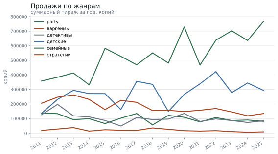
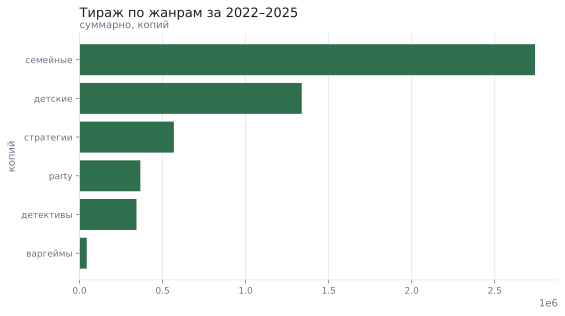
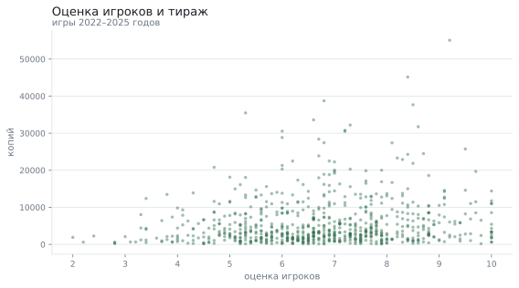

# Какие настольные игры покупают

**Вопрос:** Какие жанры настольных игр растут и стоит ли ориентироваться на оценки?

**Данные:** 3521 изданий настольных игр за 2011–2025 годы: жанр, издатель, оценки критиков и игроков, цена и тираж. Набор воспроизводим по зерну.

**Метод:** подготовка данных, выбор актуального периода, доли жанров по годам, корреляция Спирмена между оценками и продажами, критерий Манна–Уитни для сравнения оценок

## Что пришло

Исходные данные: строк 3521; полных дублей 21; пропуски: оценка_критиков — 18.0%, оценка_игроков — 9.0%. Оценки критиков есть не у всех игр: небольшие издания просто не рецензируют. Такие пропуски нельзя заполнять средним — это придумало бы рецензии, которых не было.

| Поле | Тип | Пропусков | Доля пропусков | Уникальных | Пример |
|---|---|---|---|---|---|
| название | str | 0 | 0.0% | 3500 | Игра №1 |
| год | int64 | 0 | 0.0% | 15 | 2012 |
| жанр | str | 0 | 0.0% | 6 | детские |
| издатель | str | 0 | 0.0% | 6 | Хобби Мир |
| оценка_критиков | float64 | 635 | 18.0% | 70 | 4.0 |
| оценка_игроков | float64 | 317 | 9.0% | 81 | 3.3 |
| цена | float64 | 0 | 0.0% | 3392 | 3971.29 |
| продано_копий | int64 | 0 | 0.0% | 2953 | 2289 |

## Какой период считать актуальным

Подготовка: убрано дублей 21; было 3521 строк, стало 3500. Для выводов о сегодняшнем рынке взяты последние 4 года (2022–2025): в них 971 изданий (27,7% каталога). Более ранние годы оставлены для сравнения динамики, но не участвуют в выводах о текущих предпочтениях.

## Динамика жанров

Семейные и детские игры растут, варгеймы сжимаются — это видно на всём горизонте.

## Жанры за 2022–2025

| Жанр | Изданий | Тираж | Доля рынка | Медианный тираж |
|---|---|---|---|---|
| семейные | 274 | 2 742 639 | 50,8% | 8 118 |
| детские | 156 | 1 337 893 | 24,8% | 6 622 |
| стратегии | 218 | 567 891 | 10,5% | 2 256 |
| party | 143 | 366 121 | 6,8% | 2 100 |
| детективы | 139 | 343 031 | 6,4% | 2 113 |
| варгеймы | 41 | 43 390 | 0,8% | 994 |

## Издатели

| Издатель | Изданий | Тираж | Средняя цена |
|---|---|---|---|
| Звезда | 189 | 1 040 223 | 2 865 ₽ |
| Мосигра | 155 | 988 639 | 2 852 ₽ |
| Хобби Мир | 156 | 881 728 | 2 962 ₽ |
| Стиль Жизни | 157 | 867 245 | 2 661 ₽ |
| Правильные игры | 165 | 843 186 | 2 888 ₽ |
| GaGa | 149 | 779 944 | 2 880 ₽ |

## Оценки и продажи

Связь оценки игроков с тиражом — 0.14 по Спирмену, оценки критиков — 0.13. Обе связи слабые: оценка не предсказывает тираж. Различие есть: распределения оценки критиков и оценки игроков отличаются (медианы 7.10 и 6.80); эффект пренебрежимо малый (+0.13).

## Что получилось

1. Самый крупный жанр последних лет — «семейные»: 50,8% тиража.
2. Семейные и детские игры растут весь период, варгеймы сокращаются примерно вдвое.
3. Оценки слабо связаны с тиражом (Спирмен 0.14): ставка на «высокий рейтинг» не окупается сама по себе.
4. Различие есть: распределения оценки критиков и оценки игроков отличаются (медианы 7.10 и 6.80); эффект пренебрежимо малый (+0.13).

## Чего это не доказывает

- Данные синтетические: тренды заложены генератором, поэтому выводы показывают метод, а не настоящий рынок.
- Тираж — не выручка: цена и скидки здесь не учитываются в расчёте дохода.
- Пропуски в оценках не случайны: у мелких изданий рецензий нет, и это смещает любую связь с оценками.
- Четыре года выбраны как компромисс между свежестью и объёмом; при другом окне выводы о динамике изменятся.

*Отчёт собран 12.09.2026 командой `analiz`; данные воспроизводимы по зерну.*
