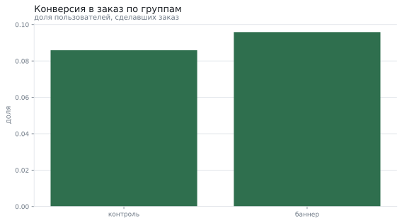
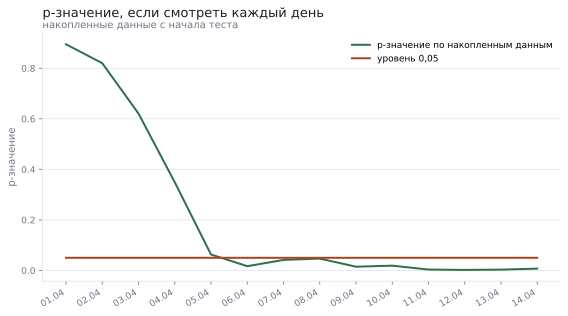
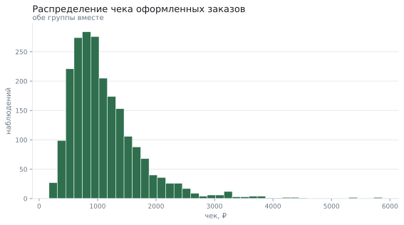

# A/B-тест баннера в приложении доставки

**Вопрос:** Увеличил ли новый баннер долю заказов и стоит ли его раскатывать на всех?

**Данные:** 24096 назначений пользователей в эксперимент за 14 дней: группа, город, платформа, факт заказа и сумма чека. Набор воспроизводим по зерну.

**Метод:** расчёт нужного размера выборки до теста, проверка сбалансированности групп, z-критерий для долей с доверительным интервалом, критерий Манна–Уитни для чека и проверка на подглядывание

## Что пришло

Исходные данные: строк 24096; полных дублей 96.

| Поле | Тип | Пропусков | Доля пропусков | Уникальных | Пример |
|---|---|---|---|---|---|
| пользователь | int64 | 0 | 0.0% | 24000 | 1 |
| группа | str | 0 | 0.0% | 2 | баннер |
| город | str | 0 | 0.0% | 4 | Новосибирск |
| платформа | str | 0 | 0.0% | 2 | iOS |
| день | object | 0 | 0.0% | 14 | 2026-04-07 |
| заказ | int64 | 0 | 0.0% | 2 | 0 |
| чек | float64 | 0 | 0.0% | 2170 | 0.0 |

## Хватит ли данных: расчёт до выводов

Подготовка: убрано дублей 96; было 24096 строк, стало 24000. Чтобы заметить прирост конверсии на 0,9% при базовой 8,6% с уровнем 0,05 и мощностью 80%, нужно 15 951 пользователей в каждой группе. Фактически в меньшей группе 11 932 — этого мало, и отрицательный результат ничего не докажет.

## Сбалансированы ли группы

До сравнения результатов проверяется состав групп: если в одной больше москвичей, разница в конверсии может объясняться этим, а не баннером. Различий не обнаружено: связь между группой и городом статистически неразличимы (таблица сопряжённости).

| Группа | Краснодар | Москва | Новосибирск | Санкт-Петербург | Всего |
|---|---|---|---|---|---|
| баннер | 1 791 | 4 824 | 2 444 | 3 009 | 12 068 |
| контроль | 1 779 | 4 721 | 2 451 | 2 981 | 11 932 |

## Конверсия в заказ

Различие есть: доли группа с баннером и контроль отличаются (9.59% против 8.59%, разница +1.00% (доверительный интервал от +0.27% до +1.72%)).

| Группа | Пользователей | Заказов | Конверсия | Доверительный интервал |
|---|---|---|---|---|
| баннер | 12 068 | 1 157 | 9,6% | 9,1% — 10,1% |
| контроль | 11 932 | 1 025 | 8,6% | 8,1% — 9,1% |

## Почему нельзя подглядывать

Если бы решение принимали в первый же день, когда p-значение опустилось ниже 0,05, тест остановили бы раньше срока: за 14 дней это случалось 8 раз до окончания эксперимента. Итоговый вывод делается один раз — по всей выборке.

## Средний чек

Чек сильно скошен вправо, поэтому сравниваются распределения, а не средние. Различий не обнаружено: распределения чек с баннером и чек в контроле статистически неразличимы (медианы 957.28 и 991.37).

## Что получилось

1. z-критерий для долей: p = 0.0072 (есть различие), разница долей 0.01
2. Прирост конверсии — +11,6% относительно контроля (8,6% → 9,6%).
3. При 300 000 пользователей в месяц это примерно 2 991 дополнительных заказов и 3 357 167 ₽ выручки.
4. Различий не обнаружено: распределения чек с баннером и чек в контроле статистически неразличимы (медианы 957.28 и 991.37).

## Чего это не доказывает

- Данные синтетические: прирост заложен генератором, числа показывают метод проверки, а не эффект настоящего баннера.
- Две недели — короткий срок: эффект новизны за это время не успевает угаснуть, и на длинном горизонте прирост может оказаться меньше.
- Проверялась одна метрика-цель; влияние на возвраты, отписки и нагрузку на поддержку не измерялось.
- Пользователи распределены случайно один раз; повторные визиты одного человека в разных группах не моделируются.

*Отчёт собран 12.09.2026 командой `analiz`; данные воспроизводимы по зерну.*
