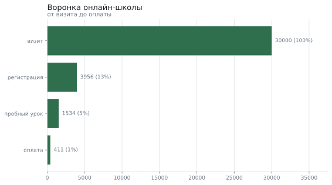
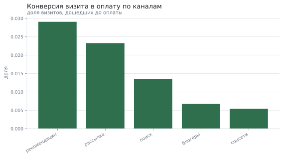
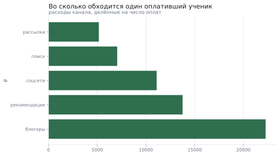
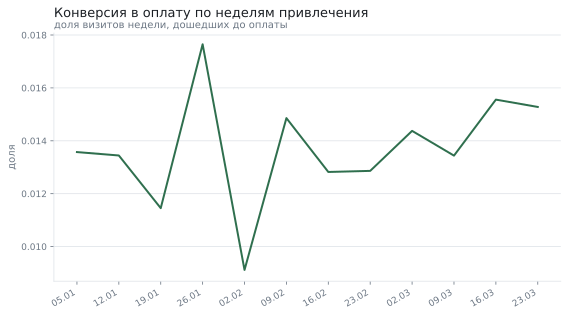

# Воронка онлайн-школы: где теряются ученики

**Вопрос:** На каком шаге воронки теряются ученики и какой канал привлечения окупается?

**Данные:** 30150 визитов за 12 недель: канал привлечения, шаги воронки (регистрация, пробный урок, оплата) и стоимость визита. Набор воспроизводим по зерну.

**Метод:** конверсия по шагам, сравнение каналов z-критерием для долей с поправкой Холма на пять сравнений, когорты по неделям и расчёт окупаемости канала

## Что пришло

Исходные данные: строк 30150; полных дублей 150.

| Поле | Тип | Пропусков | Доля пропусков | Уникальных | Пример |
|---|---|---|---|---|---|
| пользователь | int64 | 0 | 0.0% | 30000 | 1 |
| канал | str | 0 | 0.0% | 5 | блогеры |
| неделя | object | 0 | 0.0% | 12 | 2026-01-12 |
| регистрация | int64 | 0 | 0.0% | 2 | 0 |
| пробный_урок | int64 | 0 | 0.0% | 2 | 0 |
| оплата | int64 | 0 | 0.0% | 2 | 0 |
| стоимость_визита | float64 | 0 | 0.0% | 5 | 150.0 |

## Воронка целиком

Подготовка: убрано дублей 150; было 30150 строк, стало 30000. Самая большая потеря — между «визит» и следующим шагом.

| Шаг | Людей | От начала | От предыдущего шага |
|---|---|---|---|
| визит | 30 000 | 100,0% | 100,0% |
| регистрация | 3 956 | 13,2% | 13,2% |
| пробный урок | 1 534 | 5,1% | 38,8% |
| оплата | 411 | 1,4% | 26,8% |

## Каналы: конверсия в оплату

Каждый канал сравнивается с «поиском» как с самым крупным. Сравнений четыре, поэтому применяется поправка Холма — без неё один «победитель» находится случайно.

| Канал | Визитов | Оплат | Конверсия | p-значение | Значимо с поправкой |
|---|---|---|---|---|---|
| рекомендации | 3 543 | 103 | 2,9% | 0.0000 | да |
| рассылка | 4 815 | 112 | 2,3% | 0.0000 | да |
| блогеры | 4 901 | 33 | 0,7% | 0.0003 | да |
| соцсети | 7 767 | 42 | 0,5% | 0.0000 | да |

## Окупаемость

Конверсия сама по себе не решает: у канала может быть отличная конверсия и запредельная цена визита. Ниже — стоимость привлечения ученика и окупаемость при цене курса 18 900 ₽.

| Канал | Визитов | Учеников | Расходы | Стоимость ученика | Выручка | Окупаемость |
|---|---|---|---|---|---|---|
| рассылка | 4 815 | 112 | 577 800 ₽ | 5 159 ₽ | 2 116 800 ₽ | +266,4% |
| поиск | 8 974 | 121 | 852 530 ₽ | 7 046 ₽ | 2 286 900 ₽ | +168,2% |
| соцсети | 7 767 | 42 | 466 020 ₽ | 11 096 ₽ | 793 800 ₽ | +70,3% |
| рекомендации | 3 543 | 103 | 1 417 200 ₽ | 13 759 ₽ | 1 946 700 ₽ | +37,4% |
| блогеры | 4 901 | 33 | 735 150 ₽ | 22 277 ₽ | 623 700 ₽ | -15,2% |

## Недельные когорты

Конверсия держится на одном уровне все двенадцать недель — значит, различия между каналами не объясняются удачным периодом.

## Что получилось

1. Самая большая потеря — переход «визит» → «регистрация»: доходит 13,2%.
2. Лучше всех окупается «рассылка»: +266,4% при стоимости ученика 5 159 ₽.
3. Хуже всех — «блогеры»: -15,2%; при таком результате бюджет канала стоит пересобрать, а не масштабировать.
4. Каналы с высокой конверсией не всегда выгодны: решение принято по окупаемости, а не по конверсии.

## Чего это не доказывает

- Данные синтетические: конверсии и цены визитов заложены генератором.
- Учитывается только первая оплата: продления, возвраты и отток учеников не моделируются, поэтому окупаемость завышена.
- Каналы не независимы: человек видит рекламу и потом приходит из поиска — в этих данных такой переход не виден.
- Двенадцать недель — короткий период; сезонность спроса на обучение здесь не проявляется.

*Отчёт собран 12.09.2026 командой `analiz`; данные воспроизводимы по зерну.*
