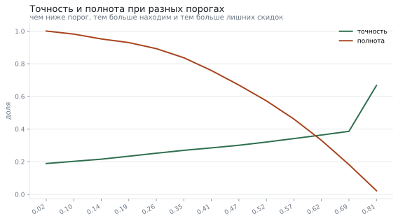
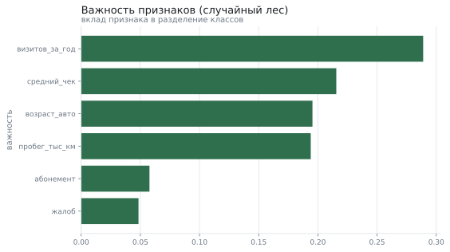

# Кто из клиентов автосервиса не вернётся

**Вопрос:** Можно ли заранее увидеть клиентов, которые больше не приедут, и кому слать скидку?

**Данные:** 6042 клиентов автосервиса: возраст и пробег машины, число визитов за год, средний чек, абонемент, жалобы и факт ухода. Набор воспроизводим по зерну.

**Метод:** подготовка данных, сравнение групп, логистическая регрессия и случайный лес с разделением на обучение и проверку, сравнение с опорным ответом и подбор порога по цене ошибки

## Что пришло

Исходные данные: строк 6042; полных дублей 42; пропуски: средний_чек — 5.1%.

| Поле | Тип | Пропусков | Доля пропусков | Уникальных | Пример |
|---|---|---|---|---|---|
| клиент | int64 | 0 | 0.0% | 6000 | 1 |
| возраст_авто | float64 | 0 | 0.0% | 201 | 6.6 |
| пробег_тыс_км | float64 | 0 | 0.0% | 1970 | 54.1 |
| визитов_за_год | int64 | 0 | 0.0% | 11 | 2 |
| средний_чек | float64 | 306 | 5.1% | 5679 | 4636.9 |
| абонемент | int64 | 0 | 0.0% | 2 | 0 |
| жалоб | int64 | 0 | 0.0% | 5 | 0 |
| тип_обслуживания | str | 0 | 0.0% | 4 | ремонт |
| месяцев_с_последнего_визита | int64 | 0 | 0.0% | 18 | 1 |
| ушёл | int64 | 0 | 0.0% | 2 | 0 |

## Что сделали с данными

Подготовка: убрано дублей 42, строк с пропусками 300; было 6042 строк, стало 5700. Доля ушедших — 18,9%. Признак «месяцев с последнего визита» намеренно исключён из модели: он известен только после того, как клиент уже ушёл, и модель с ним показала бы фантастическое качество, бесполезное на практике.

## Чем ушедшие отличаются от оставшихся

Различие есть: распределения ушедшие и оставшиеся отличаются (медианы 2.00 и 3.00); эффект небольшой (-0.36). Различие есть: доли доля абонементов у ушедших и у оставшихся отличаются (12.08% против 23.92%, разница -11.84% (доверительный интервал от -14.14% до -9.53%)).

| Показатель | Ушли | Остались |
|---|---|---|
| визитов за год (медиана) | 2 | 3 |
| средний чек (медиана) | 5 042 ₽ | 5 477 ₽ |
| доля с абонементом | 12,1% | 23,9% |
| жалоб на клиента | 0,51 | 0,33 |

## Модель и с чем её сравнивать

Данные разделены на обучение и проверку в отношении 75 на 25 с сохранением доли ушедших. Опорный ответ «никто не уйдёт» даёт точность 81,1% — любая модель обязана быть полезнее него, а «высокая точность» сама по себе ни о чём не говорит.

| Модель | ROC-AUC | Точность при пороге 0,5 | Полнота при пороге 0,5 |
|---|---|---|---|
| логистическая регрессия | 0.757 | 32,8% | 68,4% |
| случайный лес | 0.710 | 31,0% | 61,0% |
| опорный ответ «никто не уйдёт» | 0.500 | — | 0,0% |

## Порог: сколько стоит ошибка

Скидка на удержание стоит 900 ₽, потерянный клиент — 14 000 ₽. Значит, предлагать скидку выгодно всем, у кого вероятность ухода выше 6,4%. На проверочной выборке лучший порог — 0,06; при нём мы находим 99,6% ушедших, а каждая третья скидка уходит тому, кто и так вернулся бы.

|  | Предсказали «останется» | Предсказали «уйдёт» |
|---|---|---|
| На самом деле остался | 43 | 1 113 |
| На самом деле ушёл | 1 | 268 |

## Что важно для модели

Порядок признаков совпадает с тем, что видно в простом сравнении групп, — это хороший знак.

## Что получилось

1. Доля оттока — 18,9%; опорный ответ «никто не уйдёт» даёт 81,1% точности и ноль пользы.
2. Случайный лес различает классы с ROC-AUC 0.710, логистическая регрессия — 0.757.
3. При пороге 0,06, посчитанном из цены ошибки, кампания удержания на проверочной выборке даёт 2 509 100 ₽ ожидаемой выгоды.
4. Сильнее всего на уход влияют число визитов за год, жалобы и отсутствие абонемента.

## Чего это не доказывает

- Данные синтетические: зависимости заложены генератором, поэтому качество модели говорит о методе, а не о рынке.
- Признак «месяцев с последнего визита» исключён как утечка; с ним модель выглядела бы намного лучше, чем она есть.
- Выгода посчитана по средним величинам и предполагает, что скидка удерживает клиента наверняка — в жизни это не так.
- Модель обучена на одном срезе времени: сезонность и изменение цен в ней не учтены.
- Проверка — однократное разделение выборки; для решения о внедрении нужна перекрёстная проверка и период наблюдения.

*Отчёт собран 12.09.2026 командой `analiz`; данные воспроизводимы по зерну.*
