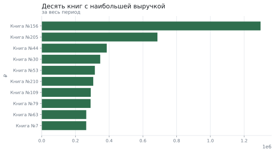
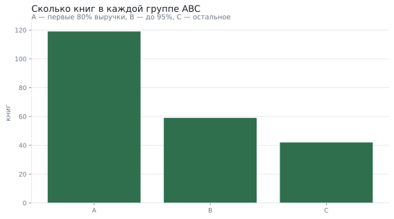
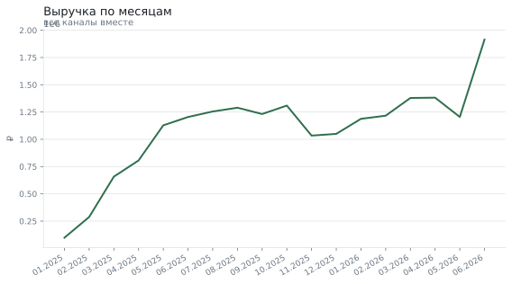

# Продажи книжного магазина: разбор на SQL

**Вопрос:** Какие книги дают выручку, как растут продажи и возвращаются ли покупатели?

**Данные:** три таблицы: 220 книг, 9000 заказов и 18048 позиций за полтора года. Наборы воспроизводимы по зерну и лежат рядом в CSV.

**Метод:** пять SQL-запросов: оконные функции, накопленные суммы, ранги внутри групп, сравнение с предыдущим месяцем и когорты

## Топ книг по выручке

Накопленная доля считается оконной функцией `sum(...) OVER (ORDER BY выручка DESC)`: это тот самый приём, который просят написать на собеседовании.

```sql
WITH выручка AS (
    SELECT п.книга_id,
           к.название,
           к.автор,
           к.жанр,
           sum(п.количество * п.цена) AS выручка
    FROM позиции п
    JOIN книги к USING (книга_id)
    GROUP BY 1, 2, 3, 4
)
SELECT название,
       автор,
       жанр,
       выручка,
       выручка / sum(выручка) OVER () AS доля,
       sum(выручка) OVER (ORDER BY выручка DESC) / sum(выручка) OVER () AS накопленная_доля
FROM выручка
ORDER BY выручка DESC
LIMIT 10
```

| Книга | Автор | Жанр | Выручка | Доля | Накопленная доля |
|---|---|---|---|---|---|
| Книга №156 | Сорокин | фантастика | 1 297 513 ₽ | 6,6% | 6,6% |
| Книга №205 | Иванов | детективы | 686 134 ₽ | 3,5% | 10,1% |
| Книга №44 | Улицкая | нон-фикшн | 385 630 ₽ | 2,0% | 12,1% |
| Книга №30 | Иванов | фантастика | 346 935 ₽ | 1,8% | 13,8% |
| Книга №53 | Улицкая | фантастика | 315 149 ₽ | 1,6% | 15,4% |
| Книга №210 | Быков | бизнес | 305 568 ₽ | 1,6% | 17,0% |
| Книга №109 | Иванов | бизнес | 290 817 ₽ | 1,5% | 18,5% |
| Книга №79 | Рубина | детские | 289 782 ₽ | 1,5% | 20,0% |
| Книга №63 | Улицкая | детективы | 264 108 ₽ | 1,3% | 21,3% |
| Книга №7 | Стругацкие | детские | 263 870 ₽ | 1,3% | 22,6% |



## ABC-анализ ассортимента

Группа A — книги, которые дают первые 80% выручки. Это стандартный приём управления ассортиментом: закупки и полки распределяются по этим группам.

```sql
WITH выручка AS (
    SELECT п.книга_id, sum(п.количество * п.цена) AS выручка
    FROM позиции п GROUP BY 1
),
накопление AS (
    SELECT книга_id,
           выручка,
           sum(выручка) OVER (ORDER BY выручка DESC) / sum(выручка) OVER () AS накопленная_доля
    FROM выручка
)
SELECT CASE WHEN накопленная_доля <= 0.8 THEN 'A'
            WHEN накопленная_доля <= 0.95 THEN 'B'
            ELSE 'C' END AS группа,
       count(*) AS книг,
       sum(выручка) AS выручка
FROM накопление
GROUP BY 1
ORDER BY 1
```

| Группа | Книг | Выручка | Доля выручки |
|---|---|---|---|
| A | 119 | 15 692 441 ₽ | 79,9% |
| B | 59 | 2 943 692 ₽ | 15,0% |
| C | 42 | 1 000 544 ₽ | 5,1% |



## Лидеры по жанрам

Ранг внутри группы — `rank() OVER (PARTITION BY жанр ORDER BY выручка DESC)`.

```sql
SELECT жанр,
       автор,
       выручка,
       ранг
FROM (
    SELECT к.жанр,
           к.автор,
           sum(п.количество * п.цена) AS выручка,
           rank() OVER (PARTITION BY к.жанр ORDER BY sum(п.количество * п.цена) DESC) AS ранг
    FROM позиции п
    JOIN книги к USING (книга_id)
    GROUP BY 1, 2
)
WHERE ранг <= 2
ORDER BY жанр, ранг
```

| Жанр | Автор | Выручка | Место в жанре |
|---|---|---|---|
| бизнес | Иванов | 599 044 ₽ | 1 |
| бизнес | Быков | 570 224 ₽ | 2 |
| детективы | Иванов | 887 223 ₽ | 1 |
| детективы | Улицкая | 569 573 ₽ | 2 |
| детские | Иванов | 511 367 ₽ | 1 |
| детские | Рубина | 318 526 ₽ | 2 |
| нон-фикшн | Иванов | 796 653 ₽ | 1 |
| нон-фикшн | Стругацкие | 541 453 ₽ | 2 |
| поэзия | Рубина | 413 544 ₽ | 1 |
| поэзия | Стругацкие | 258 338 ₽ | 2 |
| фантастика | Сорокин | 2 102 446 ₽ | 1 |
| фантастика | Быков | 860 656 ₽ | 2 |

## Помесячная динамика

Сравнение с предыдущим месяцем делается через `lag` — без него пришлось бы соединять таблицу саму с собой.

```sql
WITH помесячно AS (
    SELECT date_trunc('month', з.дата) AS месяц,
           sum(п.количество * п.цена) AS выручка,
           count(DISTINCT з.заказ_id) AS заказов
    FROM позиции п
    JOIN заказы з USING (заказ_id)
    GROUP BY 1
)
SELECT месяц,
       выручка,
       заказов,
       lag(выручка) OVER (ORDER BY месяц) AS прошлый_месяц,
       выручка / nullif(lag(выручка) OVER (ORDER BY месяц), 0) - 1 AS рост
FROM помесячно
ORDER BY месяц
```



## Когорты покупателей

Через месяц после первой покупки возвращается 58,2% клиентов. Когорта считается как месяц первой покупки, а срок жизни — через `date_diff`.

```sql
WITH первая_покупка AS (
    SELECT клиент_id, min(date_trunc('month', дата)) AS когорта
    FROM заказы GROUP BY 1
),
заказы_клиентов AS (
    SELECT з.клиент_id,
           п.когорта,
           date_diff('month', п.когорта, date_trunc('month', з.дата)) AS месяц_жизни
    FROM заказы з JOIN первая_покупка п USING (клиент_id)
)
SELECT когорта,
       count(DISTINCT клиент_id) FILTER (WHERE месяц_жизни = 0) AS клиентов,
       count(DISTINCT клиент_id) FILTER (WHERE месяц_жизни = 1) AS вернулись_через_месяц,
       count(DISTINCT клиент_id) FILTER (WHERE месяц_жизни = 2) AS вернулись_через_два
FROM заказы_клиентов
GROUP BY 1
ORDER BY 1
```

| Когорта | Клиентов | Вернулись через месяц | Через два месяца |
|---|---|---|---|
| 01.2025 | 34 | 22 | 23 |
| 02.2025 | 58 | 36 | 39 |
| 03.2025 | 109 | 59 | 65 |
| 04.2025 | 101 | 60 | 63 |
| 05.2025 | 116 | 71 | 66 |
| 06.2025 | 92 | 55 | 56 |
| 07.2025 | 129 | 76 | 69 |
| 08.2025 | 101 | 70 | 62 |
| 09.2025 | 106 | 64 | 55 |
| 10.2025 | 119 | 62 | 70 |
| 11.2025 | 93 | 50 | 53 |
| 12.2025 | 93 | 56 | 55 |
| 01.2026 | 99 | 65 | 53 |
| 02.2026 | 91 | 52 | 44 |
| 03.2026 | 111 | 65 | 61 |
| 04.2026 | 93 | 52 | 63 |
| 05.2026 | 106 | 91 | 0 |
| 06.2026 | 77 | 0 | 0 |

## Что получилось

1. Первые 80% выручки дают 119 книг из 220 (54,1% ассортимента) — это группа A, с которой работают в первую очередь.
2. Самая доходная книга приносит 6,6% всей выручки.
3. Через месяц после первой покупки возвращается 58,2% клиентов.
4. Все расчёты сделаны одним SQL: оконные функции закрывают и накопленные доли, и ранги, и сравнение с прошлым месяцем.

## Чего это не доказывает

- Данные синтетические: неравномерность продаж заложена генератором (распределение Парето).
- Возвраты, отмены и себестоимость не моделируются, поэтому «выручка» здесь — валовая.
- Когорты считаются по календарным месяцам; клиент, купивший 31-го и 1-го, попадёт в разные месяцы жизни.
- Запросы написаны под DuckDB: в PostgreSQL `date_diff` называется иначе, а `FILTER` поддерживается не везде.

*Отчёт собран 12.09.2026 командой `analiz`; данные воспроизводимы по зерну.*
